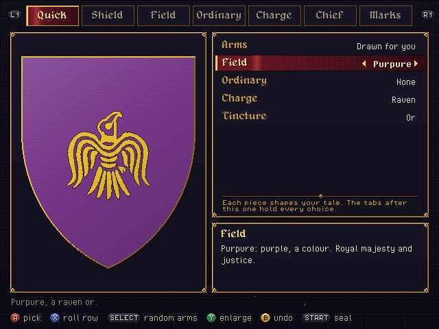
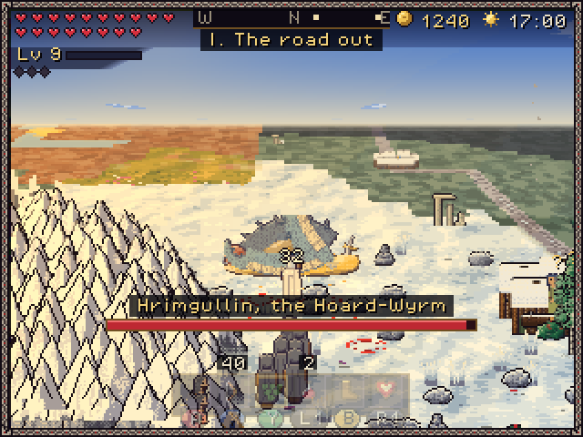
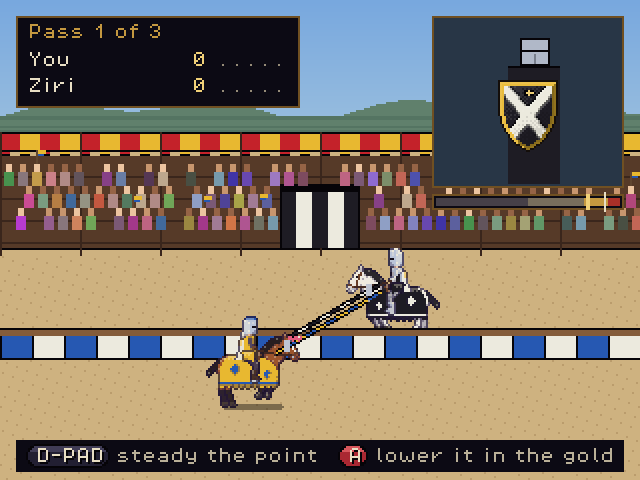
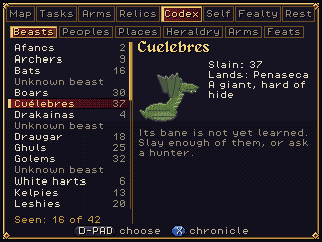
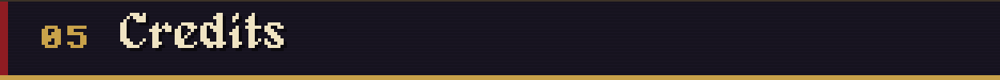

<table>
<tr><td>

https://github.com/user-attachments/assets/30e3351e-9230-40c3-af3e-d120ba68e186

An open-world RPG grown from a coat of arms you design. Your arms seal into one of
**18,446,744,073,709,551,616** seeds, and each seed is its own world: its own story, map, towns,
people and bearer. The same arms always give the same world; change one tincture and you get
another.

**Free on the Miyoo Mini Plus.** Coming soon to itch.io, Steam, macOS, Android and iOS.

     

 

 

 

- **The forge:** 6,555 heraldic charges redrawn as pixel art, every division, ordinary and line,
  and the rule of tincture kept.
- **21 peoples in three realms,** from Norse and Welsh to Byzantine, Andalusi, Persian and Bulgar,
  each with its own names, towns, buildings and music.
- **Towns, halls, lairs and the lists,** with tourneys, chess by the old rules and a codex of
  every beast you meet.
- **Made on the handheld,** with no network and no artificial intelligence.

Open **Ports** in [MiniMart](https://github.com/zakijss/MiniMart): Armiger is at the top. Or unzip
the [latest release](https://github.com/zakijss/Armiger/releases/latest) and copy its `Roms` folder
onto the SD card. Needs Onion OS.

<b>Controls</b>

| | |
|---|---|
| D-pad | walk |
| A | strike, speak |
| X | shoot (hold to aim) |
| B | roll (hold to run) |
| Y | your gift |
| L1 | a draught (hold to choose) |
| R1 | guard (hold), parry (tap) |
| Select / Start | map / journal |

Armiger updates itself from this repository over Wi-Fi, and MiniMart offers the same releases.
Every release is signed, and your saves are never touched. To check a download yourself:
`minisign -Vm armiger-<version>.zip -P RWRGexQYg+Iz7qmCsthbkahuuq2lZFD6stbL++5numHHKPnsxWhoOM1K`

By ZJSS. Charges from [heraldicon.org](https://heraldicon.org) and its artists, redrawn under
[CC BY-SA 4.0](https://creativecommons.org/licenses/by-sa/4.0/) (each original keeps its own
licence; all are listed in `CREDITS.txt`). Alagard by Hewett Tsoi (CC BY 3.0), Pixel Operator by
Jayvee Enaguas (CC0), music on the MuseScore General soundfont (MIT).

</td></tr>
</table>
