<a id="top"></a>
<table>
<tr><td>

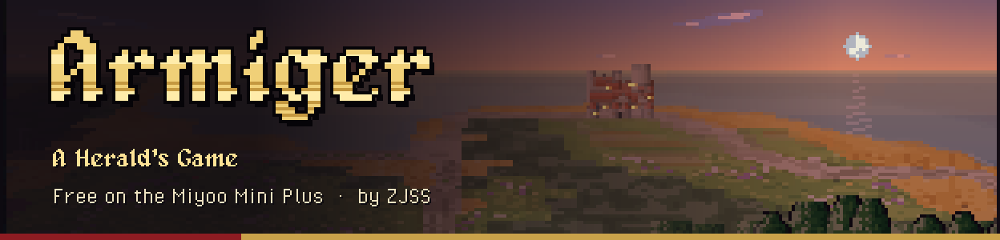

https://github.com/user-attachments/assets/30e3351e-9230-40c3-af3e-d120ba68e186

An open-world role-playing game for the Miyoo Mini Plus on Onion OS, grown from a coat of arms you
design. The same arms always tell the same story and make the same world, and it is free to play
on the Miyoo Mini family.

**6,555 heraldic charges to choose from · 21 peoples in three realms · towns, lairs, lists and the road between**

[](https://github.com/zakijss/Armiger/releases/latest) [](https://github.com/OnionUI/Onion) [](https://github.com/OnionUI/Onion) [](https://github.com/zakijss/MiniMart)

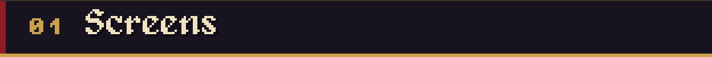

<p align="center"> 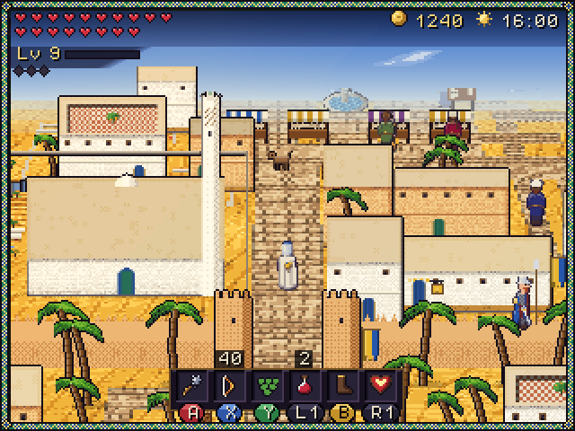</p>
<p align="center"> </p>
<p align="center">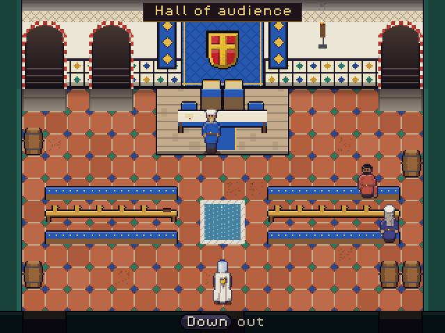 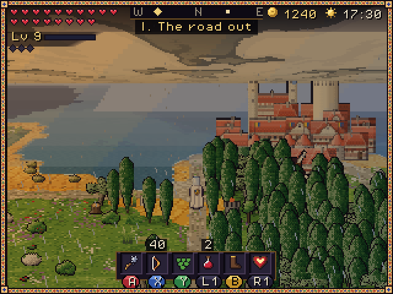</p>
<p align="center">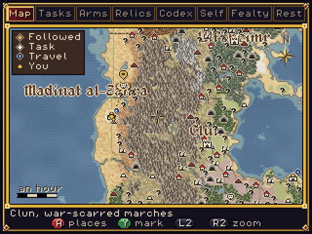 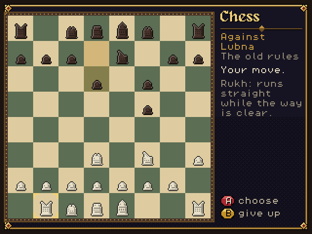</p>
<p align="center">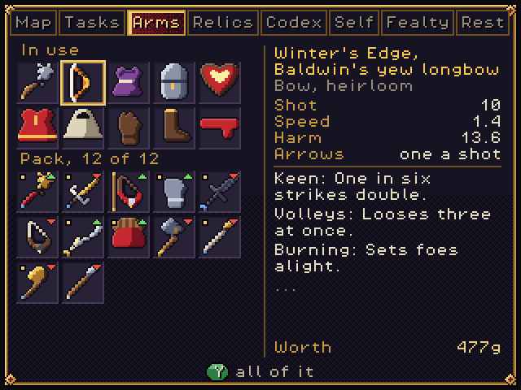 </p>

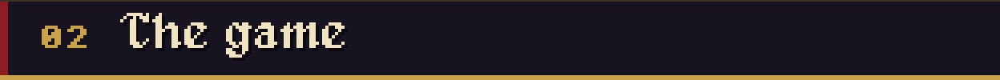

- **The forge.** You draw your arms piece by piece: shield shape and style, field, division and its
  line, ordinary, a second piece, the charge with its tincture, placement and facing, and a row of
  charges in chief. The charges are 6,555 drawings from heraldicon.org, each redrawn as pixel art.
  The forge keeps the rule of tincture: metal on colour, colour on metal.
- **Your arms make the world.** Sealing the arms turns them into a seed. The story, the lands, the
  people and your bearer all come from it, so the same arms always give the same tale, and a
  change of one tincture gives another world. The game makes all of this on the Miyoo, with no
  network and no artificial intelligence.
- **Peoples and realms.** Each land is a historical people chosen by its biome: Norse,
  Anglo-Norman, Welsh, Gaelic, Scots, Rus', German, Alpine, Byzantine, Castilian or Andalusi.
  Their names, towns, buildings and trees follow from that. Over the sea lie two more realms of
  five lands each: the Far Shore (Lithuanian, Georgian, Armenian, Shami, Maghrebi) and the
  Eastern Road (Seljuk, Persian, Khwarezmian, Kipchak, Bulgar).
- **Places to go.** Towns and villages to walk through, halls of audience, lairs, caves and the
  undercroft level by level, and the lists, where tourneys are held.
- **Music.** Each people has its own pieces for town, evening, inn, feast, land and night, made
  from its own traditional tunes.
- **On the handheld.** It vibrates under blows (Options turns that off), and the Menu button saves
  and hands back to Onion, so you can stop at any time.

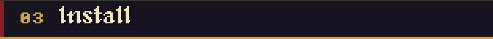

**From [MiniMart](https://github.com/zakijss/MiniMart):** open **Ports**. Armiger is at the top,
marked "By ZJSS · signed". MiniMart checks the release's signature before it installs anything.

**By hand:**

1. Download `armiger-<version>.zip` from [Releases](https://github.com/zakijss/Armiger/releases/latest).
2. Turn the Miyoo off, put its SD card in your computer, and copy the zip's `Roms` folder onto the
   card over the one already there. Only Armiger's own files are written; your other games are
   untouched.
3. Put the card back. Armiger is under **Games > Ports**, on the RPG shelf.

It needs Onion OS. No account and nothing to set up.

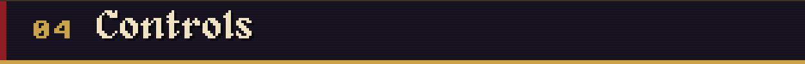

| Button | |
|---|---|
| D-pad | walk |
| A | strike, speak |
| X | shoot (hold to aim) |
| B | roll (hold to run) |
| Y | your gift |
| L1 | drink a draught (hold to choose) |
| R1 | guard (hold), or parry, tapped as a blow lands |
| Select | the map |
| Start | the journal |

The Help pages in the game explain the rest.

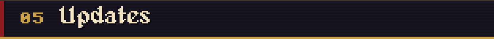

Armiger updates itself from this repository. On Wi-Fi it reads the newest release in the
background, fetches what changed while you play, and puts it in place the next time you are on the
title screen. It takes only a release signed by its maker, checks every file against that
signature before using it, and never touches your saves, which are in `Games/Armiger/saves`.

MiniMart reads the same releases, so it offers an update as soon as one is out.

Each zip also has a `.minisig` signature beside it. To check a download with
[minisign](https://jedisct1.github.io/minisign/):

```sh
minisign -Vm armiger-<version>.zip -P RWRGexQYg+Iz7qmCsthbkahuuq2lZFD6stbL++5numHHKPnsxWhoOM1K
```


Armiger is by ZJSS. This repository holds the releases only.

- The heraldic charges come from [heraldicon.org](https://heraldicon.org), drawn by its artists and
  redrawn as pixel art for Armiger. The pixel-art versions are shared under
  [CC BY-SA 4.0](https://creativecommons.org/licenses/by-sa/4.0/); each original keeps the licence
  listed with it. Every artist and charge is credited in `CREDITS.txt` inside each release.
- Alagard, the title face, is by Hewett Tsoi ([CC BY 3.0](https://creativecommons.org/licenses/by/3.0/)).
  Pixel Operator is by Jayvee Enaguas ([CC0](https://creativecommons.org/publicdomain/zero/1.0/)).
- The music is played on the MuseScore General soundfont (MIT).

The full licence texts are in the `licenses` folder of each release.

<p align="right"><a href="#top">Back to top</a></p>

</td></tr>
</table>
